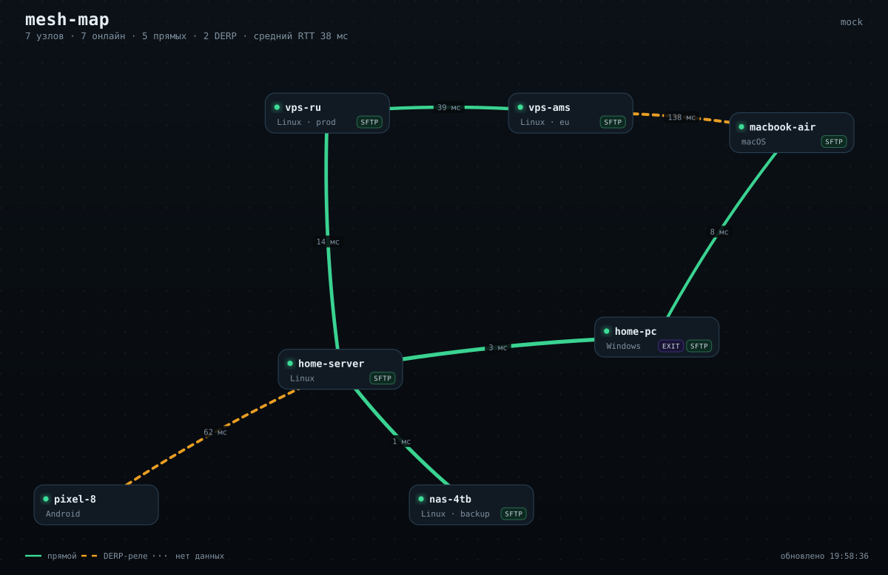

# mesh-map

**Живая карта mesh-сети: узлы, прямые пути и DERP-реле — с историей деградаций.**

Проект отвечает на вопрос, на который `tailscale status` не отвечает: *как моя сеть выглядит целиком и что в ней меняется со временем?*

<p align="center">
  
</p>

<p align="center">
  
  
  
  <a href=".github/workflows/ci.yml"></a>
</p>

---

## Зачем

Когда узлов больше двух, Tailscale превращается в чёрный ящик:

- часть трафика идёт напрямую, часть — через DERP-реле, и это видно только по одному пиру за раз;
- узел «вроде онлайн», но RTT вырос втрое, потому что путь переключился на реле;
- после инцидента хочется ответить на вопрос «а когда это началось?», но истории нет.

`mesh-map` собирает топологию по расписанию, рисует её как граф, складывает изменения в SQLite и отдаёт метрики в Prometheus.

## Что внутри

```
tailscale status --json ─┐
Tailscale API ───────────┼─→ collector → diff → SQLite (история + события)
mock (демо/тесты) ───────┘                │
                                          ├─→ SVG-рендер (server-side, без JS-графа)
                                          ├─→ SSE → живой веб-дашборд
                                          ├─→ SSH-проба (баннер) → карточка узла
                                          ├─→ sftp:// → FileZilla / sites.xml
                                          ├─→ /metrics (Prometheus)
                                          └─→ /badge.svg (для README)
```

Три источника данных:

| Провайдер | Что даёт | Когда использовать |
|---|---|---|
| `mock` | синтетическая сеть из 7 узлов, периодически «ломается» один путь | демо, тесты, скриншоты — **по умолчанию** |
| `tailscale` | реальные узлы + тип пути (прямой / DERP), трафик | на машине, где стоит Tailscale |
| `api` | узлы и их доступность через официальный API | в контейнере без доступа к сокету Tailscale |

> В публичном репозитории демо работает на `mock` — настоящие хостнеймы и IP в git не попадают.

## Быстрый старт

```bash
python -m venv .venv
.venv/Scripts/activate          # Windows
# source .venv/bin/activate     # Linux/macOS

pip install -e ".[dev]"
python -m meshmap serve --provider mock
# → http://127.0.0.1:8765/
```

Реальный режим:

```bash
python -m meshmap serve --provider tailscale --interval 10
```

Если хочется задержки, а не только тип пути:

```bash
python -m meshmap serve --provider tailscale --probe-rtt
```

> `--probe-rtt` использует `tailscale ping`. Он же прогревает путь: пир, который «висел» на DERP, после пинга может перейти на прямой. Поэтому по умолчанию RTT не измеряется — карта показывает то, что о пути знает сам Tailscale.

Разовый рендер в файл (например, для README):

```bash
python -m meshmap snapshot --provider mock --tick 10 --out docs/demo.svg
```

## Docker

```bash
docker compose up --build
```

В `docker-compose.yml` есть закомментированный блок `mesh-map-live` — режим с доступом к сокету Tailscale и `network_mode: host`.

## Клик по устройству → файлы (FileZilla или WinSCP)

Карта не только показывает сеть, но и доводит до действия: клик по узлу открывает карточку с адресом, состоянием SSH и кнопкой **Открыть в FileZilla** (или **в WinSCP** — что найдётся).

Что происходит под капотом:

1. Коллектор проверяет SSH-порт каждого онлайн-узла: TCP-коннект + чтение баннера (`SSH-2.0-OpenSSH_9.6p1 …`). Без аутентификации — в логах узла не появляется неудачных логинов.
2. Карточка собирает `sftp://user@tailnet-ip:22/` и открывает его через `filezilla <url>` или `WinSCP.exe <url>` — оба понимают такой диплинк.
3. Пароль в URL не передаётся: клиент спрашивает его сам и может сохранить в своём хранилище.
4. Если задан ключ, WinSCP открывает сессию сразу, без диалога. WinSCP понимает только PuTTY-формат, поэтому новый OpenSSH-ключ конвертируется один раз:
   ```bash
   winscp.com /keygen "%USERPROFILE%\.ssh\id_ed25519" /output="%USERPROFILE%\.ssh\id_ed25519.ppk"
   ```
   Путь к `.ppk` подхватывается автоматически, если он лежит рядом с ключами; иначе задай `MESHMAP_SSH_KEY`.
5. Кнопка **Все узлы → Site Manager** отдаёт `sites.xml` — один импорт (`File → Import`) и вся сеть появляется в Site Manager с именем, ОС и пометкой «через DERP».

Что видно на карте:

- бейдж **SFTP** — порт отвечает, можно подключаться;
- бейдж **EXIT** — узел объявлен exit-node;
- бейдж **этот ПК** — узел, на котором запущен сам дашборд: SFTP к себе нужен только при настроенном ключе;
- если клиента нет, кнопка неактивна, а подсказка предлагает `winget install WinSCP` и ручной импорт `sites.xml`.

> FileZilla убрали из winget по просьбе разработчиков, а официальный сайт отдаёт только installer со спонсорскими предложениями. Поэтому клиент ищется в стандартных путях, а WinSCP — полноценная альтернатива: тот же `sftp://`, тот же SFTP.

```bash
# путь к клиенту, если стоит не в стандартном месте (FileZilla или WinSCP)
MESHMAP_FILEZILLA="C:\\Program Files\\FileZilla FTP Client\\filezilla.exe"

# под каким пользователем заходить; можно переопределить по хосту:
# MESHMAP_SSH_USERS="home-server=root,vps-ams=deploy"
MESHMAP_SSH_USER=ubuntu

# если sshd слушает не 22
MESHMAP_SSH_PORT=22

# ключ для WinSCP (PuTTY .ppk); без него клиент спросит пароль
MESHMAP_SSH_KEY="C:\\Users\\me\\.ssh\\id_ed25519.ppk"

# выключить проверку SSH-портов (например, в чужой сети)
MESHMAP_PROBE_SSH=0

# запретить запуск локальных приложений из браузера
MESHMAP_ALLOW_LAUNCH=0
```

> **Безопасность.** Дашборд по умолчанию слушает `127.0.0.1`, а запуск приложений разрешён только с того же origin. `/api/state` отдаёт tailnet-адреса узлов — не выставляй сервис в интернет без аутентификации. Для демо в публичном репозитории используется `mock`: синтетические имена и адреса из `100.101.1.0/24`.

## Эндпоинты

| Путь | Что отдаёт |
|---|---|
| `/` | живой дашборд (SSE, обновление раз в секунду при изменениях) |
| `/graph.svg` | текущая карта как SVG |
| `/badge.svg` | компактная карточка со сводкой |
| `/metrics` | Prometheus: узлы, пути, RTT по каждому ребру, `meshmap_ssh_up`, ошибки сбора |
| `/api/state` | снапшот в JSON |
| `/api/nodes/{id}` | карточка узла: `sftp`, `ssh_command`, связи, состояние SSH |
| `/api/nodes/{id}/site.xml` | один узел как файл для импорта в Site Manager |
| `/api/nodes/{id}/filezilla` (POST) | запустить FileZilla/WinSCP на `sftp://` (409, если клиента нет) |
| `/api/filezilla` | какой клиент найден и разрешён ли запуск |
| `/filezilla/sites.xml` | все онлайн-узлы одним файлом для Site Manager |
| `/api/history` | события и таймлайн за 6 часов |
| `/healthz` | 200/503 |

## События

Коллектор сравнивает снапшоты и пишет в историю:

- `node` — узел появился или вернулся в сеть;
- `warn` — узел ушёл в офлайн или пропал;
- `path` — путь переключился `прямой → DERP fra` или обратно;
- `latency` — RTT вырос более чем в 1.8 раза и минимум на 15 мс;
- `info` — первичная загрузка топологии.

Именно эти события превращают картинку в инструмент: видно не «сейчас плохо», а «плохо стало в 14:32, когда macbook ушёл на реле».

## Как это устроено

- **Раскладка** — force-directed в чистом Python, детерминированная: позиции сохраняются между тиками, карта не прыгает. Узлы дополнительно расталкиваются как прямоугольники.
- **Рендер** — SVG на сервере, без клиентских библиотек. Работает и в дашборде, и как картинка в README.
- **Живость** — SSE: сервер присылает новый SVG только когда состояние изменилось.
- **SSH-проба** — TCP-коннект и чтение баннера: видно, что SFTP реально доступен, и какая версия sshd стоит. Никаких паролей и попыток логина.
- **FileZilla / WinSCP** — `sftp://`-диплинк плюс экспорт `sites.xml`; пароли не покидают клиент.
- **Хранение** — SQLite: `snapshots` (последние 5000) и `events`. Этого достаточно, чтобы переживать рестарты и отвечать на «а что было ночью».
- **Никаких секретов в репозитории** — токен API читается из `TS_API_TOKEN`, в `.env.example` пусто.

## Ограничения

Честно о том, чего нет:

- `api`-провайдер не знает тип пути (API Tailscale его не отдаёт) — рёбра помечаются как `unknown`;
- на consumer-железе нет MIG, поэтому «изоляция по GPU» здесь не при чём — проект только про сеть;
- история хранится в SQLite и не предназначена для миллионов точек: это домашняя observability, а не замена Grafana Cloud;
- RTT по умолчанию не измеряется: `tailscale status` его не отдаёт, нужен `--probe-rtt` (это лишние пинги).

## Roadmap

- [ ] алерт в Telegram при переходе прямого пути на DERP;
- [ ] `mesh-map diff --since 1h` — текстовый отчёт по изменениям;
- [ ] экспорт таймлайна в Grafana (SQLite datasource);
- [ ] SSH-ключи и известные хосты: проверка `known_hosts` перед подключением;
- [ ] подстановка SFTP-пути из тегов (`tag:share` → `/srv/share`);
- [ ] сравнение нескольких tailnet-ов;
- [ ] gRPC/WebSocket вместо SSE для больших сетей.

## Лицензия

MIT.
